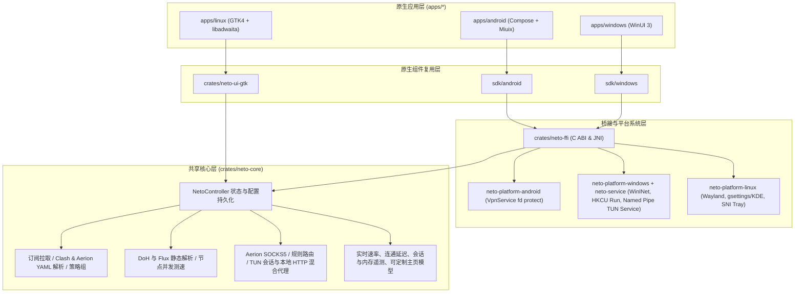

# Neto 架构说明

## 分层设计

`Neto` 参考 FlClash 等多端客户端的分层思路，将业务逻辑与状态统一下沉到跨平台 Rust 核心，同时彻底放弃 WebView/Electron 套壳，在各目标桌面与移动端均采用原生系统组件与原生 UI 框架：

## 核心模块职责

- `NetoController`（`crates/neto-core/src/engine.rs`）：
  - 维护持久化存储 `neto_store.json`，包含全局设置、主页卡片配置、多订阅记录、当前激活订阅与选中节点。
  - 暴露统一的 `dispatch_json(method, params)` 接口，供 Android JNI、Windows C ABI 以及 Rust 原生前端（GTK4）直接调用。
- `profile.rs`：
  - 支持远程订阅 URL 拉取（解析 `subscription-userinfo` 响应头中的上传/下载/总额度与到期时间）与本地 YAML 配置导入。
  - 自动内联展开 HTTP `rule-providers` 规则集，并保留 `proxy-groups` 策略组与节点延迟记录。
  - 提供 `upsert_managed_profile` 接口，允许 `XBClient` 等商业客户端将鉴权后获取的节点、路由规则和套餐配额直接同步进 `NetoController`。
- `dashboard.rs`：
  - 定义 `network_speed`、`active_connections`、`exit_check`、`traffic_usage`、`profiles_summary`、`latency_probe`、`runtime_info` 七类主页状态模块，支持启用/隐藏、顺序重排与恢复默认，不与主页顶部连接/节点/模式控制重复。

## 平台系统组件

- **Android**：`NetoVpnService` 跟踪非 VPN 物理网络（`ConnectivityManager`）并通过 `bindSocket` + `protect` 保护底层出站连接，避免 Wi-Fi / 蜂窝切换后断流；使用 `<queries>` 声明兼容应用分流枚举。
- **Windows**：主界面始终以普通用户权限（`asInvoker`）运行；全局 TUN 接管由独立的 `neto-service.exe`（`LocalSystem` Windows 服务）搭配 `wintun.dll` 承载，主进程通过命名管道 `\\.\pipe\<AppId>TunService` 下发与停止 TUN 会话，首次开启或服务未就绪时按需单次提权安装并启动服务；`neto-platform-windows` 调用 Win32 `InternetSetOptionW` 配置系统代理并在 `HKCU\Software\<AppId>\SystemProxy` 备份与还原代理设置。
- **Linux Wayland**：默认启用 `GDK_BACKEND=wayland,x11`，通过 `ksni` 实现符合 freedesktop `StatusNotifierItem` 规范的 D-Bus 原生托盘菜单，并自动识别 GNOME `gsettings` 与 KDE `kwriteconfig6`/`kwriteconfig5` 应用系统代理。
